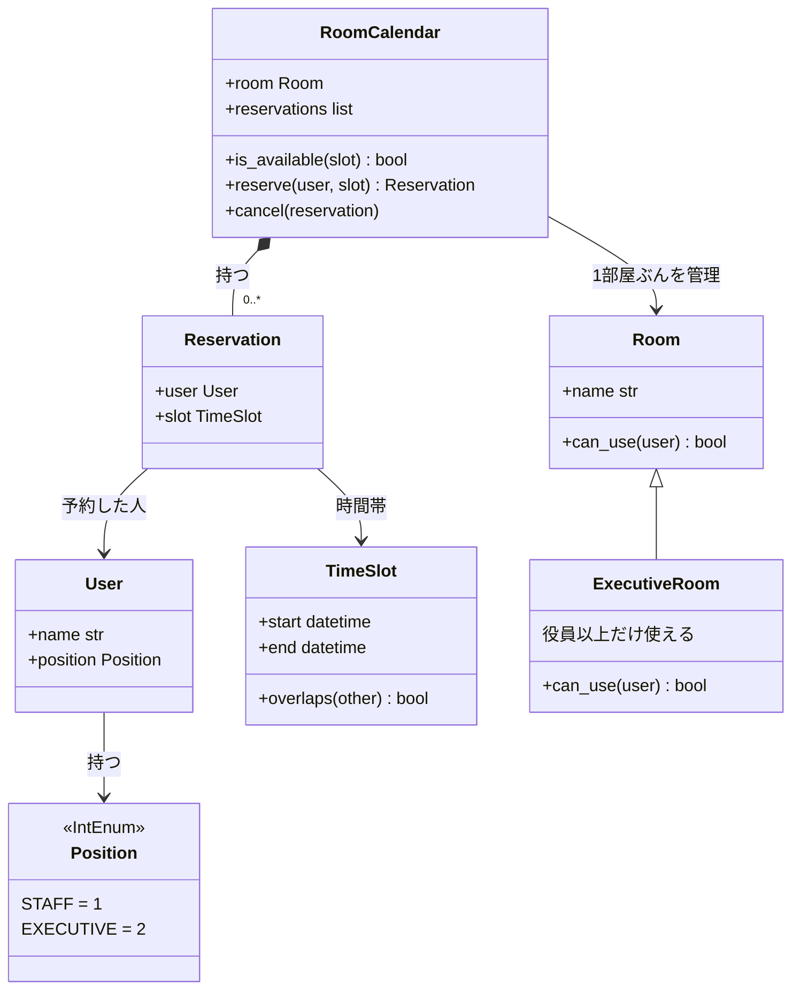

# 06_meeting_room_contracts: 設計図

会議室予約の設計メモです。図は [Mermaid](https://mermaid.js.org/) です（VS Code の Markdown プレビュー / GitHub で描画できます）。

**設計の前提**
- 要求は 4 つだけ。人数・定員・営業時間は扱わない
- 予約の管理は `RoomCalendar`（1部屋につき1つ）に集める
- 「使える人か」の判断は `Room` 自身が持つ（`can_use`）。役員用会議室はこれを上書きする
- 契約違反（バグ）は `assert`、業務上の失敗は `is_available` で事前に確認する

---

## 1. クラス図

## 2. 要求と担当クラス

| # | 要求 | 担当 |
| --- | --- | --- |
| 1 | 会議室と時間を指定して枠を予約できる | `RoomCalendar.reserve` |
| 2 | 先客がいたら取れない | `RoomCalendar.is_available`（`TimeSlot.overlaps` で判定） |
| 3 | 予約を解除して枠を返せる | `RoomCalendar.cancel` |
| 4 | 役員用会議室は役員以上が使える | `ExecutiveRoom.can_use` |

## 3. 契約の置き場所

| 対象 | 種類 | 内容 |
| --- | --- | --- |
| TimeSlot | 不変条件 | `start < end` |
| TimeSlot.overlaps | 事後条件 | 左右を入れ替えても結果が同じ（対称性） |
| Room | 不変条件 | 名前が空でない（`""` や `None` は不可） |
| RoomCalendar | 不変条件 | 予約同士の時間帯が重ならない |
| reserve | 事前条件 | 空いている（`is_available`）／その人が部屋を使える（`can_use`） |
| reserve | 事後条件 | 予約が 1 件増える。不変条件も守られている |
| cancel | 事前条件 | その予約が存在する |
| cancel | 事後条件 | 予約が 1 件減る |

## 4. 山場：壊してから直す（LSP）

`reserve` の事前条件に `can_use` を入れた**最終形**は、LSP 違反ではありません。呼ぶ側が `room.can_use(user)` を確認していれば、どの部屋でも契約を守れるからです。違反になるのは、`Room` の契約に「誰でも予約できる」と読める約束があるときです。実際には、次の順で進めました。

1. `reserve` が `can_use` を見ない状態で `ExecutiveRoom` を作った
2. 「一般社員は役員用会議室を予約できない」のテストが Red になった（`DID NOT RAISE AssertionError`）。`Room` の「誰でも予約できる」という約束を、`ExecutiveRoom` が破った状態
3. `reserve` の事前条件に `can_use` を加えて Green にした。「使えるかは `can_use` で聞く」を契約の一部にしたので、呼ぶ側が確認する責任を負う

## 5. icontract への置き換え

手書きの `raise AssertionError` を、`icontract` のデコレータに置き換えました（`icontract.ViolationError` は `AssertionError` のサブクラスなので、テストはそのまま通ります）。

| 契約 | 書き方 |
| --- | --- |
| 不変条件 | クラスに `@icontract.invariant` |
| 事前条件 | メソッドに `@icontract.require` |
| 事後条件 | メソッドに `@icontract.ensure`（呼ぶ前の件数は `@icontract.snapshot` で覚える） |

**注意**: 基底クラスに契約があっても、サブクラスで上書きしたメソッドには、そのままでは契約が引き継がれません。引き継ぎたいときは、基底クラスに `icontract.DBC` を継承させます（今回は `can_use` に契約を付けていないので、使っていません）。

## 予約情報の置き場所（リポジトリ）
- `CalendarRepository`（`get`）が部屋ごとの `RoomCalendar` を預かる。重ならない不変条件は部屋の中で閉じているので、部屋単位が集約になる
- `RoomCalendar` は可変なので、同じ実体を返す（`reserve` するとそのまま次の `get` に反映される）
- 未登録の部屋の `get` と二重登録は、呼ぶ側の責任として事前条件（icontract）で守る
