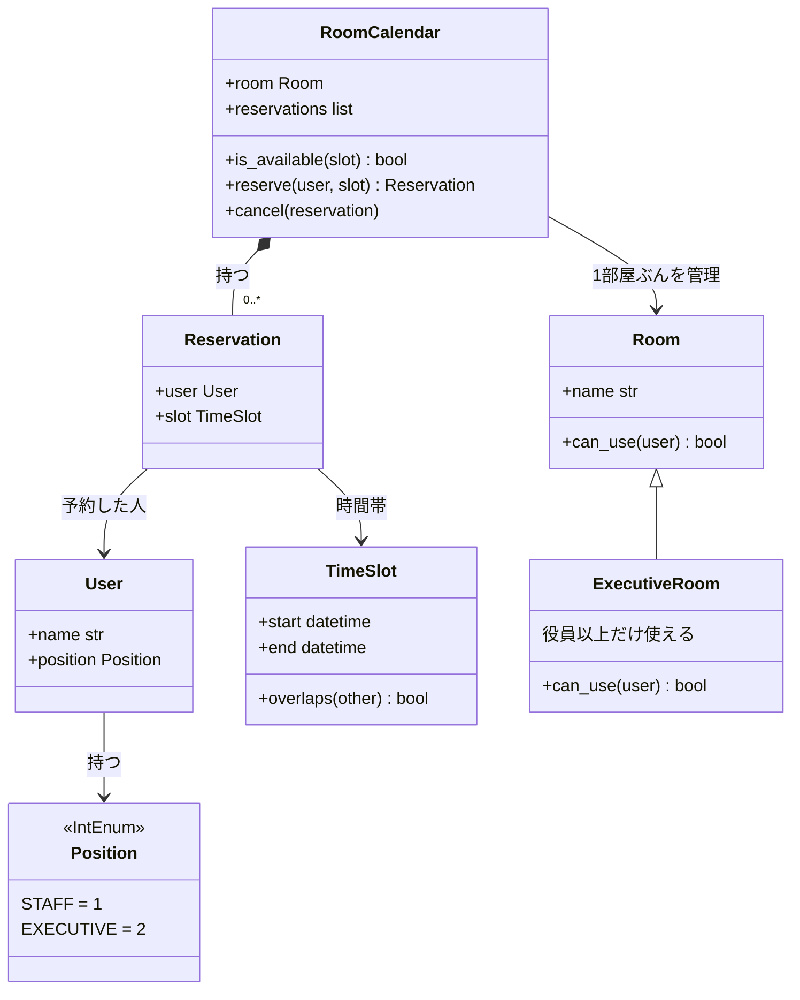

# 06_meeting_room_contracts: 設計図

会議室予約の設計メモです。図は [Mermaid](https://mermaid.js.org/) です（VS Code の Markdown プレビュー / GitHub で描画できます）。

**設計の前提**
- 要求は 4 つだけ。人数・定員・営業時間は扱わない
- 予約の管理は `RoomCalendar`（1部屋につき1つ）に集める
- 「使える人か」の判断は `Room` 自身が持つ（`can_use`）。役員用会議室はこれを上書きする
- 契約違反（バグ）は `assert`、業務上の失敗は `is_available` で事前に確認する

---

## 1. クラス図

## 2. 要求と担当クラス

| # | 要求 | 担当 |
| --- | --- | --- |
| 1 | 会議室と時間を指定して枠を予約できる | `RoomCalendar.reserve` |
| 2 | 先客がいたら取れない | `RoomCalendar.is_available`（`TimeSlot.overlaps` で判定） |
| 3 | 予約を解除して枠を返せる | `RoomCalendar.cancel` |
| 4 | 役員用会議室は役員以上が使える | `ExecutiveRoom.can_use` |

## 3. 契約の置き場所

| 対象 | 種類 | 内容 |
| --- | --- | --- |
| TimeSlot | 不変条件 | `start < end` |
| TimeSlot.overlaps | 事後条件 | 左右を入れ替えても結果が同じ（対称性） |
| Room | 不変条件 | 名前が空でない（`""` や `None` は不可） |
| RoomCalendar | 不変条件 | 予約同士の時間帯が重ならない |
| reserve | 事前条件 | 空いている（`is_available`）／その人が部屋を使える（`can_use`）※最終形。手順 4 では最初 `can_use` を入れない |
| reserve | 事後条件 | 予約が 1 件増える。不変条件も守られている |
| cancel | 事前条件 | その予約が存在する |
| cancel | 事後条件 | 予約が 1 件減る |

## 4. 山場：壊してから直す（LSP）

`reserve` の事前条件に `can_use` を入れた**最終形**は、LSP 違反ではありません。呼ぶ側が `room.can_use(user)` を確認していれば、どの部屋でも契約を守れるからです。違反になるのは、`Room` の契約に「誰でも使える」と読める約束があるときです。そこで、わざと違反する版を先に作ります。

1. `Room` の契約を「誰でも予約できる」にする（`reserve` に `can_use` のチェックを置かない）
2. `ExecutiveRoom` を作る。一般社員の予約で契約が破れ、テストが落ちるのを見る（事前条件を強めた = LSP 違反）
3. 直す。`can_use` を `reserve` の事前条件に入れ、呼ぶ側が確認する形にする
