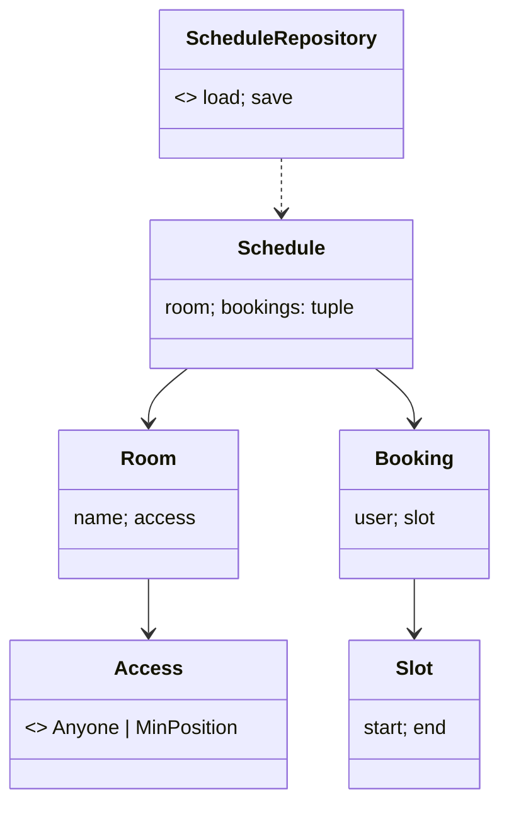

# 07 設計メモ（06 との対比）

## 設計前提
- データは `frozen dataclass`、コレクションは `tuple`。一度作ったら変えない
- 振る舞いは純粋関数。同じ入力なら同じ出力で、元の値は壊さない
- 失敗は `Ok` / `Err` の値。`reserve` は `Ok((新Schedule, Booking))` か `Err(NotAllowed | Overlapped)`

## 1. 型と関数

関数: `make_slot` / `overlaps` / `can_use` / `is_available` / `reserve` / `cancel`
（端の殻: `ScheduleRepository.load` / `save`、`reserve_room` / `cancel_booking`。詳しくは §5）

## 2. 06 との対比

| 論点 | 06 (OOP + 契約) | 07 (FP) |
| --- | --- | --- |
| `start < end` | クラス不変条件。違反は例外 | `make_slot` が `Err(InvalidSlot)` を返す。直接 `Slot(...)` と書いても `__post_init__` が `ValueError` で弾く |
| 予約の状態 | `RoomCalendar` が可変で持つ | `Schedule` は不変。`reserve` が新しいものを返す |
| 重複禁止（不変条件） | 全メソッドの前後で全ペア検査 | `Schedule.__post_init__` が作る瞬間に全ペア検査。不変なので作った後は壊れない |
| `reserve` の事前条件 | `@require`。破るとバグ（例外） | `Err(NotAllowed / Overlapped)` を値で返す |
| 事後条件（件数+1） | `@snapshot` + `@ensure` | テストで「新は+1、元は不変」を確かめる |
| 役員室 | `ExecutiveRoom` が継承で `can_use` を上書き | `Room.access` というデータ + `can_use` 1つ |

## 3. LSP が消えた話
06 では継承で事前条件を強めると LSP 違反になりうる。07 では「誰が使えるか」をデータ（`Anyone` / `MinPosition`）にしたので、サブタイプ関係自体がなく、置換の問題も起きない。

## 4. `__post_init__` で不変条件を守る
最初の07は、`Schedule(room, bookings=...)` と直接書くと重複した予約を作れた。そこで `Slot` と `Schedule` の `__post_init__` に不変条件の検査を足した。

- 検査は**作る瞬間の1回だけ**。frozen なので、作った後に壊れることがない（06のように全メソッドの前後で検査しなくてよい）
- 通常の失敗は引き続き `Err` で返す。`make_slot` と `reserve` は先に確認するので、`ValueError` は出ない。`ValueError` が出るのは「直接作った」というバグのときだけ
- つまり**バグは例外、業務上の失敗は `Err`** という06の区別が戻った

### まだ残るトレードオフ
- `__post_init__` は例外を投げるので、「例外を使わない」という07の方針からは少し外れる
- 事後条件（件数+1など）は、相変わらずテストで確かめるだけ

## 5. 予約情報の置き場所（リポジトリ）
- `ScheduleRepository`（`load` / `save`）は**端**に置く。`reserve` / `cancel` は今まで通り純粋関数のまま
- `use_cases.py` の `reserve_room` / `cancel_booking` が「読む → 純粋関数で決める → 書く」をつなぐ薄い殻
- `Schedule` は不変なので、保存は「新しい値に置き換える」。`Err` のときは `save` しないので、保存内容は変わらない
- 06 は可変の `RoomCalendar` を預かるが、07 は不変の `Schedule` を預かる
